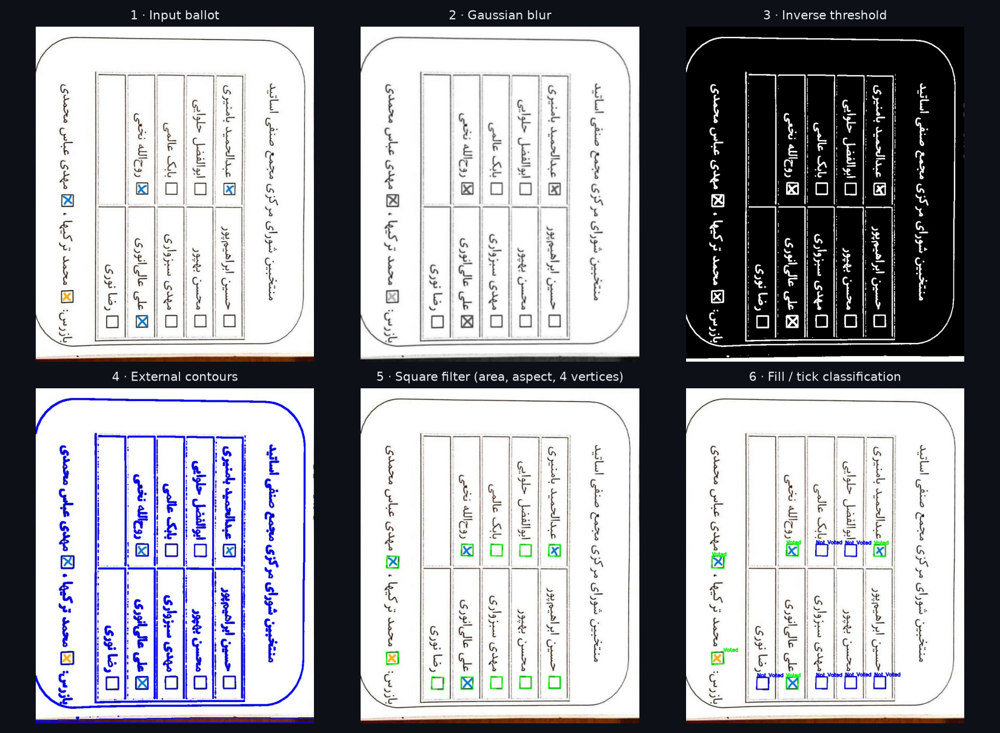
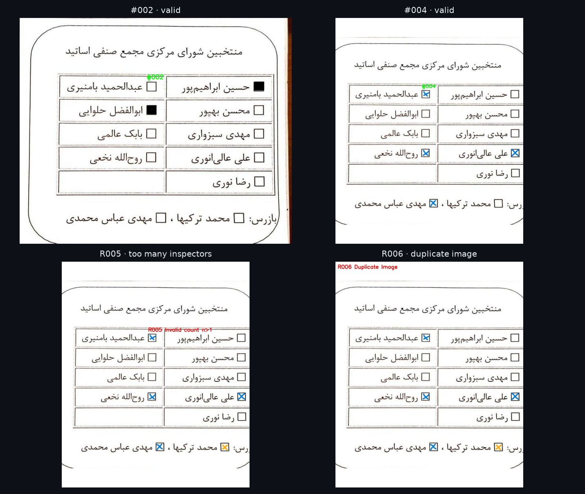

<div align="center">

# Automated Paper-Ballot Vote Counter

**Classical computer-vision pipeline for reading, validating and tallying scanned ballots**

*Fundamentals of Computer Vision — Course Project, University of Kashan*
**Sina Mozaffari Rad** · Student ID 40021160214


</div>

---

## Overview

The program takes photos of filled-in paper ballots for a faculty council election: nine council nominees
plus two inspectors. It works out which boxes were marked, checks each ballot against the election rules,
detects re-submitted copies of the same ballot, and produces the final tally as CSV reports.

It uses no machine learning. Every stage is classical image processing (geometry correction, thresholding,
contour analysis, Hough transforms and perceptual hashing), so each decision can be inspected and explained.

## Pipeline

<p align="center"></p>

| Stage | Technique | Purpose |
|-------|-----------|---------|
| **Skew correction** | Canny edges → probabilistic Hough lines → median angle → affine rotation on a padded canvas | Straightens hand-held or rotated photos without cropping corners |
| **Pre-processing** | Grayscale → 5×5 Gaussian blur → inverse binary threshold | Suppresses paper texture and noise; separates ink from paper |
| **Checkbox detection** | External contours filtered by area (500–5000 px²), aspect ratio (0.9–1.1) and polygon approximation to 4 vertices | Isolates the square checkboxes from text and table lines |
| **Ordering** | Sort by (y, x) | Maps each box to its candidate |
| **Mark classification** | Masked mean intensity **or** Hough line segments inside the box | Detects both fully filled boxes and ✓ / ✗ tick marks |
| **Duplicate detection** | Perceptual hash (pHash) of each image + exact vote-vector matching | Rejects the same ballot submitted twice, even after re-compression |
| **Rule validation** | Blank ballot · more than *N* nominees · more than *n* inspectors | Applies the election rules (*N*, *n* set at run time) |
| **Reporting** | pandas → UTF-8-BOM CSV | Produces Excel-compatible Persian tables |

## Results

<p align="center"></p>

Valid ballots are numbered `#NNN`. Rejected ones are labelled `RNNN` with the reason drawn on the image. On the
sample set of six ballots:

| Output | Content |
|--------|---------|
| [`valid_votes.csv`](results/valid_votes.csv) | 3 accepted ballots with their per-candidate vote vectors |
| [`invalid_votes.csv`](results/invalid_votes.csv) | 3 rejected: one blank ballot, one with too many inspectors marked, one duplicate image |
| [`final_report.csv`](results/final_report.csv) | Total valid ballots and votes per nominee / inspector |

## Usage

```bash
pip install -r requirements.txt
python ballot_counter.py
```

1. Enter the maximum number of nominees (*N*, default 5) and inspectors (*n*, default 1) allowed per ballot.
2. Select one or more ballot images in the file dialog. Sample ballots are in `samples/`.
3. The intermediate stage images are shown. Labeled images are saved next to the inputs as `*_labeled.jpg`,
   and the three CSV reports are written to the working directory.

## Repository Structure

```
ballot_counter.py        Full pipeline: correction, detection, validation, reporting
samples/                 Input ballot photos
results/                 Labeled outputs and CSV reports
docs/figures/            Stage-by-stage images
docs/make_figures.py     Builds the README figures
```
